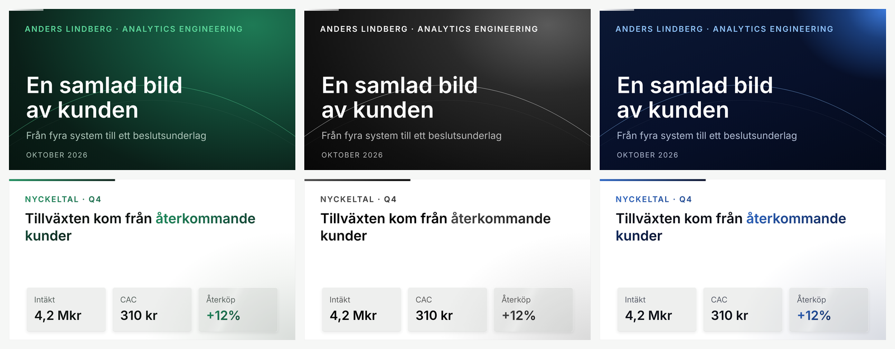
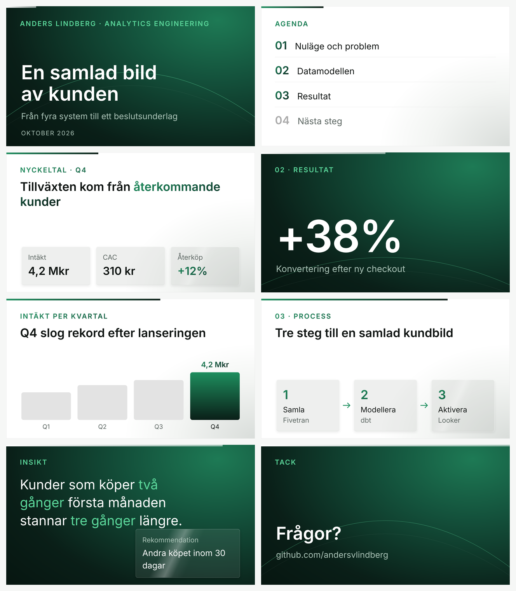
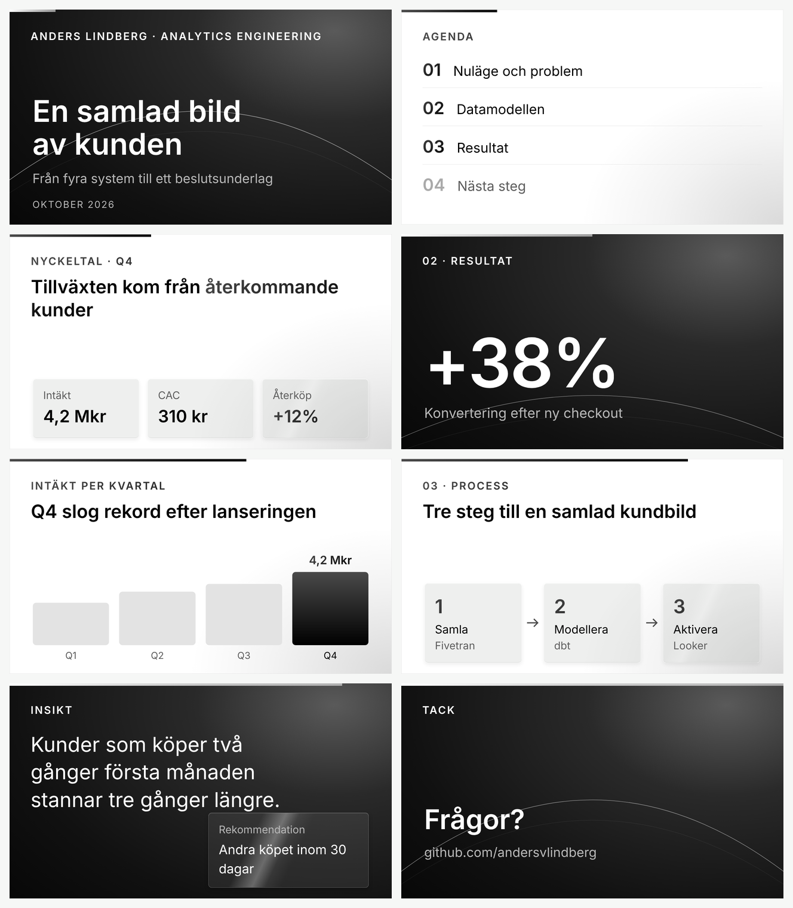
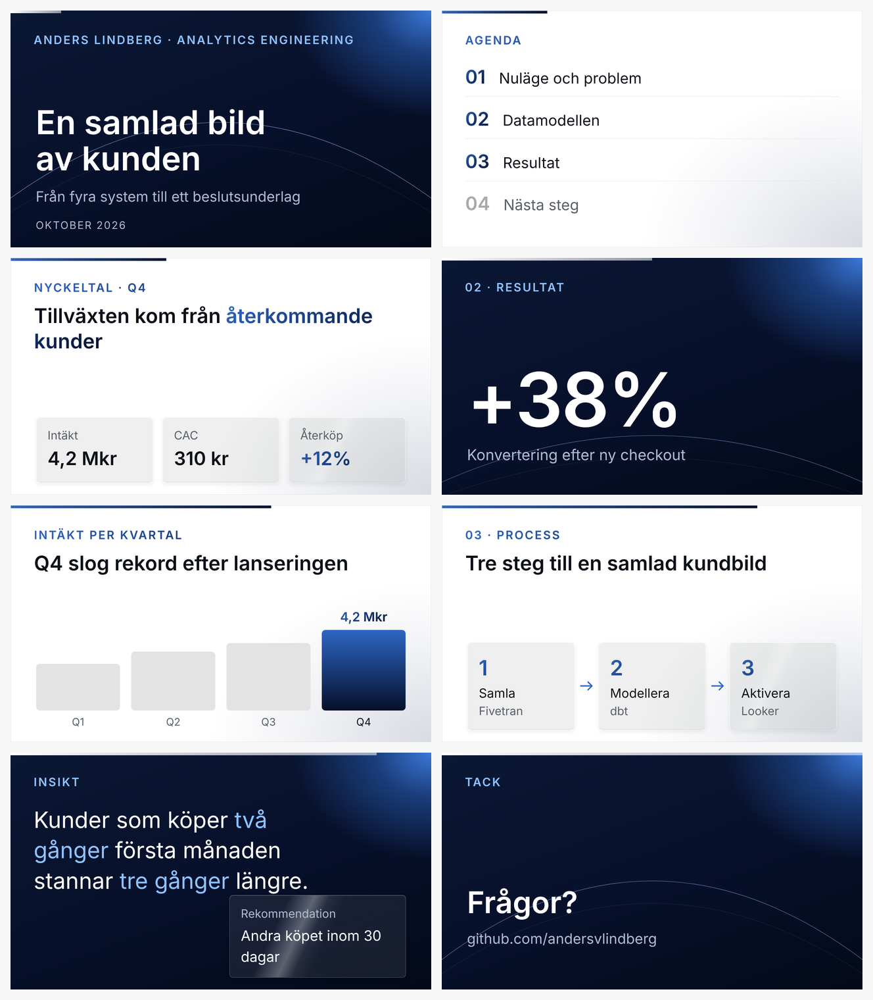

# Anders Design System

**Min personliga designprofil för presentationer: tre paletter, ett system.** Mörkt sätter tonen, ljust förklarar, och glas och en brobåge binder ihop allt.

**[Öppna den interaktiva förhandsvisningen](https://andersvlindberg.github.io/anders-design-system/preview/)** och växla mellan paletterna.

> *English summary: a personal presentation design system with three palettes (forest green, graphite, navy), frosted-glass cards, a signature arc motif and a progress line, with design tokens in JSON and CSS, an interactive preview and a PowerPoint build guide.*

## Idén

Jag vill vara **bryggan mellan verksamhet och teknik**, och profilen är byggd på den idén. Signaturmotivet är en båge som spänner över hela sliden. Den används bara i de stora ögonblicken: när presentationen börjar, när den viktigaste siffran visas och när det är dags att avsluta.

## Paletter

| | Mörkt läge | Accent | Ljust läge |
|---|---|---|---|
| **Grön skog** (huvudtema) | Skogsgradient med glöd uppe till höger | `#5BD69A` | Vit dimma, text i skogsgradient |
| **Svart och vit** | Grafitglöd mot svart | `#FFFFFF` | Grå dimma, text i svart gradient |
| **Mörkblå** | Djup marin med ljus glöd i hörnet | `#8EC2FF` | Vit dimma, text i blå gradient |

### Grön skog

### Svart och vit

### Mörkblå

## Byggstenar

| Byggsten | Regel |
|---|---|
| **Rytm** | Mörkt för titel, siffra, insikt och avslut. Ljust för innehåll. |
| **Glaskort** | Samma grå glas på alla kort, glansreflex bara på hjältekortet. |
| **Brobågen** | Stort över hela sliden, bara på titel, stor siffra och avslut. |
| **Framstegslinje** | 2 px uppe till vänster som växer genom presentationen. Vit på mörkt, accent på ljust. |
| **En hjälte per slide** | En siffra, ett ord eller en stapel i accent. Resten neutralt. |

Alla regler finns i [`docs/principer.md`](docs/principer.md).

## Använd profilen

| Fil | Innehåll |
|---|---|
| [`tokens/tokens.json`](tokens/tokens.json) | Alla färger, gradienter, glasvärden och motiv |
| [`tokens/tokens.css`](tokens/tokens.css) | CSS-variabler och klasser (`.ads-glass`, `.ads-gradient-text`). Byt tema med `data-theme="skog\|grafit\|marin"`. |
| [`preview/index.html`](preview/index.html) | Interaktiv förhandsvisning av alla åtta layouter. Öppna i webbläsaren och byt palett. |
| [`docs/powerpoint.md`](docs/powerpoint.md) | Exakta värden för att bygga allt i PowerPoint, plus animeringsplanen |

## Färdplan

- [x] Paletter, glas, brobåge, framstegslinje och åtta layouter
- [ ] Typsnittspar och typskala
- [ ] PowerPoint-mall (.potx) med alla tre paletterna och animeringar
- [ ] Komponenter för tabeller, tidslinjer och citat

## Licens

Koden är MIT-licensierad. Själva profilen (namn, motiv och kombinationen av färger) är min personliga stil. Låna gärna idéer, men gör din egen version.
